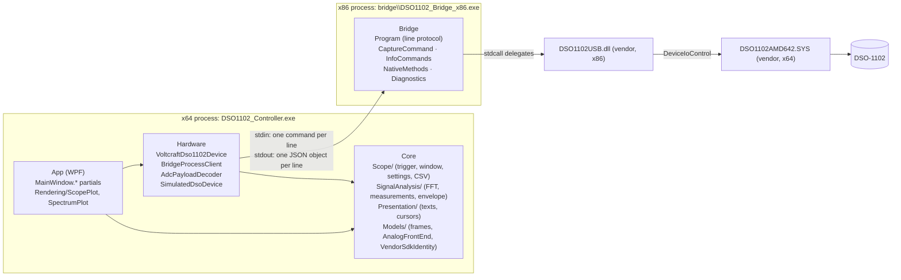
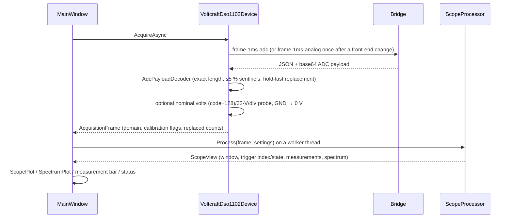

# Architecture

## Context and goals

The DSO-1102-USB is only controllable through the manufacturer's 32-bit `DSO1102USB.dll`,
which talks to the signed x64 kernel driver `DSO1102AMD642.SYS` via `DeviceIoControl`. The
goals are:

1. a 64-bit desktop application with a modern UI and signal analysis;
2. no guessed device commands: only vendor-DLL calls whose ABI and arguments are verified by
   static analysis plus runtime traces of the original application;
3. everything that does not need the instrument is testable on any machine.

## Components

| Project | Target | Responsibility |
|---|---|---|
| `DSO1102.Controller.Core` | net8.0 | UI-free domain logic: models, DSP, software trigger, view processing, formatting, settings, CSV |
| `DSO1102.Controller.Hardware` | net8.0 | `IDsoDevice` implementations: real device via bridge, simulator |
| `DSO1102.Controller.App` | net8.0-windows, x64 | WPF shell, theme, plots; no domain logic |
| `DSO1102.Controller.Bridge` | net8.0-windows, x86 | Hosts the vendor DLL; one long-lived process per device session |
| `DSO1102.Controller.CallTrace` | net8.0-windows, x86 | Diagnostic debugger that records vendor-application calls (evidence gathering only) |
| `tests/DSO1102.Controller.Tests` | net8.0 | Dependency-free runner; doubles as fake bridge process |

## Bridge protocol

The client starts `DSO1102_Bridge_x86.exe server --dll <path>` and keeps it for the session.

| Command | Purpose | Device effect |
|---|---|---|
| `probe` | Find device index 0..3, FPGA version | read-only |
| `frame-1ms-adc` | Re-apply the verified 1 ms/div time-base profile, force-trigger, return both channels | transient time base |
| `frame-1ms-analog r1 r2 c1 c2` | As above, after the transient analog sequence (range 5..7, coupling 0/1) | transient time base + analog |
| `quit` | End the process | — |

Responses are single-line JSON with `ok`, the echoed `command` and, for frames,
`capture.adcPayload` (`u16le-base64`, 524,288 samples/channel). Frame commands omit the
full-buffer diagnostics (`diagnosticsOmitted: true`); the diagnostic commands
(`info`, `capture-*`, `self-init-*`, `exports`, `sdk-info`) keep them and are only reachable
through `tools/Run-HardwareProbe.ps1`. The client allow-list
(`BridgeProcessClient.IsProtocolCommand`) and the bridge use the same argument parser
(`AnalogFrontEnd.TryParseFrameArguments`).

Robustness: one command at a time (semaphore), 15 s timeout, cancellation kills the process,
any protocol error discards the process and the next command starts a fresh one.

## Data flow of one frame

Settings changes re-process the displayed frame (latest settings win, one evaluation at a time;
the FFT is reused when only trigger or display scale changed).

## Key decisions

| Decision | Alternatives | Reason |
|---|---|---|
| Out-of-process x86 bridge | 32-bit app; own x64 IOCTL client; WinUSB/libusb | No 64-bit DLL exists; an IOCTL client would send unverified transactions; replacing the driver breaks the vendor software |
| Software trigger on the full record | Programming hardware trigger (`_dsoSetTrigIn@32`) | Trigger setter mapping is not runtime-traced yet; the ~105 ms record contains many edges |
| Time base as a window of the record | Switching hardware time-base codes | Codes 15..18 all deliver the same ~5 MS/s stream; self-init is runtime-verified for 400 µs and 1 ms/div, the app uses 1 ms/div |
| Nominal volts behind an opt-in | Showing volts by default | Offset midpoint 128 and 32 codes/div are family evidence, not a per-unit calibration |
| Fingerprint gate on the DLL | Trust file name / exports | Reconstructed stdcall ABI is only valid for the analysed binary |
| Dependency-free test runner with fake bridge child | xUnit + mocks | Exercises real pipes, timeouts and process restarts; runs anywhere |

## Where to change what

| Task | Place |
|---|---|
| New measurement | `Core/SignalAnalysis/SignalAnalyzer.cs`, text in `Core/Presentation/DisplayFormat.cs` |
| Trigger/window behaviour | `Core/Scope/SoftwareTrigger.cs`, `ScopeProcessor.cs` |
| Plot appearance | `App/Rendering/*`, tokens in `App/Themes/Theme.xaml` |
| New verified vendor call | Bridge `CaptureCommand.cs`/`NativeMethods.cs`, allow-list in `BridgeProcessClient`, evidence in `docs/REVERSE_ENGINEERING.md` |
| Newly traced V/div range | `Core/Models/AnalogFrontEnd.cs` (single table) plus UI segment |
